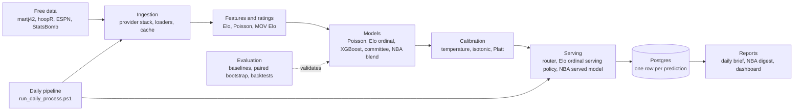

# ALTTEZ Predictive Engine

[](https://github.com/julianhr-ops/alttez-predictive/actions/workflows/ci.yml)
[](LICENSE.txt)


**Live demo:** [julianhr-ops.github.io/alttez-predictive](https://julianhr-ops.github.io/alttez-predictive/) shows the live NBA scoreboard, the soccer validation and a matchup calculator. How it is built is in [docs/site.md](docs/site.md).

ALTTEZ produces win probabilities for international football (1X2 and scorelines) and for NBA games from free public data, and it measures every model before trusting it. A daily pipeline ingests results, serves predictions, stores each prediction once, grades it after the game, and builds a report. The core of the project is the evaluation harness. Each model is scored walk-forward against simple baselines on identical games, with paired bootstrap confidence intervals, and the repository keeps the findings that went against its own models.

## Why it is different

- **Walk-forward validation.** Every test period is predicted only from data that came before it. Hyperparameters, calibrators and blend weights are fitted on earlier seasons or years and never on the period being scored. Ratings score a game from the state before its date, so a prediction cannot see its own result.
- **Baselines on the same games.** Uniform, base rate, plain Elo and the NBA closing line are scored on the identical matches as the model. Beating a coin flip is not reported as a win.
- **Uncertainty on every comparison.** `alttez/evaluation/paired.py` resamples per-game loss differences, in blocks of game dates when games share a day, and reports a 95% interval. A difference counts only when the interval excludes 0.
- **The legacy soccer model lost to plain Elo, and the fix was measured before it was served.** The audit found that the original Poisson champion is worse than an Elo-only baseline on Brier, RPS and log loss, pooled and in 7 of 8 test years, with a draw bias that one temperature cannot fix. The harness then scored eight candidate replacements. Selection used 2018 to 2022 only, and 2023 to 2025 were kept as an untouched final test. The chosen Elo ordinal rule beat the Poisson champion there by Brier -0.0728 [-0.0836, -0.0623] on 3,191 matches, and it is now served by default through `alttez/inference/serving_policy.py`. The Poisson score matrix is rescaled to the Elo 1X2 so scorelines stay coherent, and `ALTTEZ_SERVING_POLICY=off` restores plain Poisson. The same report says the rule is statistically equivalent to plain Elo, so the win is mostly "use Elo" ([docs/validation_soccer.md](docs/validation_soccer.md)).
- **NBA Elo does not beat the closing line.** Elo beats the constant home rate and vanilla Elo, but it does not beat the market close in any test season. A blend of Elo and the market line only reproduces the line. So the served prediction defers to the market-based blend whenever a line exists, and uses calibrated Elo only for games with no line ([docs/nba.md](docs/nba.md)).
- **Leakage and duplication fixed with tests.** The audit found and fixed a calibration fitted on one shape and applied to another, duplicate prediction rows that inflated the learning data, an Elo K factor that treated qualifiers as finals, and a registry failure that silently served the fallback ([docs/model-history.md](docs/model-history.md)). NBA predictions are keyed on game, model version and served model, written while the game is scheduled and never rewritten after tip-off. A line that appears after the first prediction adds a blend row beside the Elo row, and the scoreboard counts each game once.

## Results

Every number below is copied from a validation report, and each report names the command that reproduces it.

### NBA, walk-forward, test seasons 2020-21 to 2025-26

7,776 games were played in the test seasons and 7,764 of them have a closing line. The table is scored on those 7,764 games so every row sees the same games. Source is [docs/nba.md](docs/nba.md), reproduced with `python scripts/nba_validate.py`.

| model | Brier | log loss | accuracy | ECE |
| --- | --- | --- | --- | --- |
| constant home rate | 0.2473 | 0.6878 | 0.554 | 0.011 |
| vanilla Elo | 0.2199 | 0.6295 | 0.646 | 0.013 |
| MOV Elo | 0.2174 | 0.6240 | 0.651 | 0.012 |
| MOV Elo + Platt | 0.2173 | 0.6238 | 0.652 | 0.012 |
| market close | 0.2067 | 0.5995 | 0.678 | 0.012 |
| Elo + market blend | 0.2070 | 0.6004 | 0.679 | 0.010 |

The paired bootstrap, by game date, pooled over the six test seasons, says MOV Elo beats the constant rate and vanilla Elo. Against vanilla Elo its log loss difference is -0.0055 [-0.0078, -0.0032], a gain of about 0.005. It does not beat the market close in any season. Pooled, its log loss is +0.0245 [+0.0202, +0.0288] worse than the market. The blend gives the Elo logit a coefficient of about zero and the market logit about 1.03, so it reproduces the market. Its Brier difference against the market is +0.0004 [-0.0000, +0.0008] and its log loss difference is +0.0009 [+0.0000, +0.0017].

### Soccer 1X2, walk-forward

Source is [docs/validation_soccer.md](docs/validation_soccer.md). The work has two stages, a diagnosis of the legacy Poisson champion on 2018 to 2025 and a held-out test of a replacement.

**Stage 1, diagnosis.** 7,611 identical international matches, test years 2018 to 2025, reproduced with `python scripts/validate_soccer.py --refit-days 1 --workers 10` (33 minutes in the report).

| model | Brier | RPS | log loss | accuracy |
| --- | --- | --- | --- | --- |
| uniform | 0.6667 | 0.2390 | 1.0986 | 0.475 |
| base rate | 0.6350 | 0.2282 | 1.0527 | 0.475 |
| Elo only | 0.5148 | 0.1707 | 0.8741 | 0.597 |
| Poisson raw | 0.5811 | 0.1998 | 0.9760 | 0.526 |
| Poisson + temperature | 0.5811 | 0.1996 | 0.9761 | 0.526 |

Paired bootstrap, model minus baseline, lower is better. Poisson raw against Elo only is Brier +0.0663 [+0.0585, +0.0735], so the Poisson champion is worse. Poisson raw against base rate is -0.0539 [-0.0605, -0.0476], so it beats the base rate. Poisson + temperature against Poisson raw is Brier +0.0000 [-0.0007, +0.0007], so calibration changes nothing measurable. The accuracy of the uniform and base-rate rows is the home-win share, because both always pick home.

**Stage 2, selection and held-out test.** Eight candidate rules were declared and compared on 2018 to 2022 only, and the simplest one inside the noise of the best was chosen, an Elo ordinal rule (Elo ratings with a fitted draw model). It was committed as the primary candidate before 2023 to 2025 were scored. Those three years are an untouched test of 3,191 matches, reproduced with `python scripts/validate_soccer.py --refit-days 1 --raw-cache-dir artifacts/soccer/raw --report-years 2023 2025 --candidates elo_ordinal`.

| model | Brier | RPS | log loss | accuracy |
| --- | --- | --- | --- | --- |
| uniform | 0.6667 | 0.2389 | 1.0986 | 0.467 |
| base rate | 0.6381 | 0.2295 | 1.0569 | 0.467 |
| Elo only | 0.5142 | 0.1700 | 0.8714 | 0.599 |
| Poisson raw (legacy champion) | 0.5855 | 0.2014 | 0.9812 | 0.522 |
| Poisson + temperature | 0.5862 | 0.2015 | 0.9821 | 0.522 |
| Elo ordinal draw | 0.5127 | 0.1694 | 0.8700 | 0.602 |

Elo ordinal against Poisson raw, paired bootstrap, 2023 to 2025, is Brier -0.0728 [-0.0836, -0.0623], RPS -0.0320 [-0.0364, -0.0278] and log loss -0.1113 [-0.1271, -0.0955]. The Brier interval is below 0 in each of the three years. The draw over-prediction is gone. On the held-out years the mean predicted draw rate is 0.224 for Elo ordinal and 0.283 for Poisson raw, against 0.233 observed.

The gain comes from using Elo, not from the fitted draw model. Elo ordinal against plain Elo only is Brier -0.0015 [-0.0025, -0.0004] on the held-out years, and over 2018 to 2025 (selection years included) it is -0.0003 [-0.0010, +0.0003]. The report treats the two Elo rules as equivalent in accuracy and prefers the fitted one for serving because its draw rate is calibrated and it comes with a coherent score matrix. A blend with the Poisson 1X2 added nothing.

## Architecture



[docs/architecture.md](docs/architecture.md) has the detailed diagram and a module-level walkthrough.

## Tech stack

- Python 3.13 with pandas, NumPy, SciPy, scikit-learn, XGBoost and PyMC for the models, and Optuna for tuning.
- PostgreSQL on Supabase through SQLAlchemy and psycopg, with 16 forward-only SQL migrations in `sql/supabase/migrations/`.
- Streamlit and Altair for the dashboard.
- `unittest` for tests, Ruff for lint, and GitHub Actions for CI and the scheduled daily run.
- PowerShell for the daily orchestrator, `scripts/run_daily_process.ps1`.

## Quickstart

You need Python 3.13 or newer. These commands run on Linux, macOS and Windows and need no database and no API key.

```bash
git clone https://github.com/julianhr-ops/alttez-predictive.git
cd alttez-predictive
python -m venv venv
```

Activate the environment with `source venv/bin/activate` on Linux and macOS, or `venv\Scripts\Activate.ps1` in Windows PowerShell. Then install the dependencies and run the checks.

```bash
python -m pip install -r requirements.txt
python -m unittest discover -s tests
python scripts/nba_validate.py
python scripts/nba_daily.py --dry-run
python scripts/nba_daily.py --dry-run --html out.html
python scripts/validate_soccer.py --help
```

- `unittest discover` runs the offline test suite. Tests never use the network.
- `nba_validate.py` downloads the hoopR files into `artifacts/nba/`, runs the NBA walk-forward validation, writes `artifacts/nba/validation.json` and prints the markdown report.
- `nba_daily.py --dry-run` predicts the games on the ESPN scoreboard and prints the digest without opening a database. It refuses to predict and exits with code 3 when the data is stale. Add `--html out.html` to also write the digest as a self-contained HTML page.
- `validate_soccer.py` runs the soccer backtest. A full run takes tens of minutes, so start with `--help`.

The database, the dashboard and the daily process need configuration. `.env.example` is the template, [docs/provider-stack.md](docs/provider-stack.md) covers the providers, and [docs/ai/workflows.md](docs/ai/workflows.md) covers the local workflows (in Spanish).

To browse predictions, start the dashboard with `python -m streamlit run alttez/dashboard/app.py` and pick `NBA` in the sidebar. It needs `SUPABASE_DB_URL` for data and shows a no-database message with the dry-run command when the variable is missing.

## Project layout

```text
alttez/
  api/          database engine, settings, migration runner
  dashboard/    Streamlit application, with the NBA view in nba_view.py
  evaluation/   baselines, paired bootstrap, metrics, soccer backtest
  experiments/  tournament oracle and World Cup research code
  features/     Elo, Poisson, Klement features, preprocessing
  inference/    router, committee, calibration, World Cup 2026 simulator
  ingestion/    provider stack, certification, historical seed, result backfill
  models/       model wrappers inherited from ProphitBet
  nba/          NBA data, models, validation, prediction, storage
  network/      connectivity helpers
  operations/   prediction memory, artifact store, alerts, expansion policy
  reports/      daily brief, tournament review, NBA digest, Telegram delivery
  training/     trainer, tuner, champion and challenger cycle
scripts/        command-line entry points and the PowerShell daily orchestrator
sql/supabase/   numbered migrations, 001 to 016
tests/          unittest suite and fixtures
docs/           architecture, validation reports, model history, provider stack, notes in docs/ai
storage/        tournament review state and World Cup 2026 configuration
.github/        CI and the scheduled daily workflow
```

## Data sources and licenses

| Source | Used for | License or terms |
| --- | --- | --- |
| [hoopR-nba-data](https://github.com/sportsdataverse/hoopR-nba-data) | NBA schedule and closing lines | [CC BY 4.0](https://creativecommons.org/licenses/by/4.0/), attribution required. The repository does not redistribute the files. The scripts download them at run time and cache them under `artifacts/nba/`. |
| [martj42/international_results](https://github.com/martj42/international_results) | International match history | CC0 |
| [StatsBomb Open Data](https://github.com/statsbomb/open-data) | Optional event data from a local clone | Attribution to StatsBomb required when the data is used. |
| ESPN public JSON | Live scoreboards and the odds ESPN relays | Unofficial endpoints, used for personal and educational purposes. They can change without notice. ALTTEZ has no affiliation with ESPN. |
| football-data.org | Optional fixtures and results | Free API key and the provider's terms. |

Schedule and betting-line data come from sportsdataverse/hoopR-nba-data (CC BY 4.0). ALTTEZ drops non-NBA franchise ids and duplicate rows, converts tip-off times to US dates and normalises the sign of the spread. The odds that ESPN shows come from DraftKings and belong to a third party. Nothing here is affiliated with the NBA, ESPN, DraftKings or any bookmaker.

## Limitations and known follow-ups

- The soccer serving rule is Elo based. Its edge over plain Elo is inside the noise, so the validated claim is "Elo beats the Poisson champion", not "the fitted draw model beats Elo". A class-specific correction of the Poisson 1X2 and a Poisson model with Elo inputs are untested.
- A team with no Elo rating, or a match the support gate rejects, keeps the Poisson path and is flagged as a fallback. Calibration of the served Elo 1X2 is not applied, since the existing temperature was fitted on Poisson output.
- The soccer backtest scores 7,611 of 7,829 test-year matches. The router abstains on the other 218 because a team has fewer than 5 matches in the last 4 years.
- XGBoost, the hierarchical and bivariate Poisson models, the committee consensus and the tournament simulation are not evaluated in the backtest.
- The Elo constants come from the original code. Whether they were tuned on the test years is unknown.
- NBA Elo adds no measurable information to the closing line. Its value is coverage of games that have no line yet.
- The NBA blend is fitted on odds-API closing lines from hoopR. Live lines come from ESPN, usually DraftKings. The live scoreboard in the NBA digest checks that gap and shows an interval only from 30 lined games.
- The scheduled workflow runs only on the owner's repository and needs a Supabase database and secrets. A fork runs the tests and the validation scripts but not the daily process.
- Dashboard and brief strings are in Spanish, and so is part of the docs under `docs/ai/`.

## Disclaimer

ALTTEZ is a research and engineering project. Its output is a statistical result and not betting advice or financial advice. Nobody should stake money on it. Team and league names appear only to identify the data.

## License and credits

MIT, see [LICENSE.txt](LICENSE.txt). The code began as a reshaping of [ProphitBet](https://github.com/kochlisGit/ProphitBet-Soccer-Bets-Predictor) by Vasileios Kochliaridis, whose copyright notice stays in the license. The ALTTEZ name is the owner's. Citation metadata is in [CITATION.cff](CITATION.cff).

## Resumen en español

**Demo en vivo:** [julianhr-ops.github.io/alttez-predictive](https://julianhr-ops.github.io/alttez-predictive/). La página está en inglés y se actualiza dos veces al día.

ALTTEZ calcula probabilidades de victoria para fútbol internacional (1X2 y marcadores) y para partidos de la NBA usando solo datos públicos y gratuitos. Cada modelo se valida con el método walk-forward, contra modelos de referencia sobre los mismos partidos y con intervalos de confianza de bootstrap pareado. El repositorio conserva los resultados negativos. La auditoría mostró que el campeón Poisson de fútbol era peor que un Elo simple. Se evaluaron ocho reglas candidatas, se eligió una con los años 2018 a 2022 y se probó en 2023 a 2025, que no se usaron para elegir. La regla ganadora, un Elo ordinal con modelo de empates, mejora al campeón Poisson con una diferencia de Brier de -0.0728 [-0.0836, -0.0623] sobre 3,191 partidos, y hoy se sirve por defecto (`ALTTEZ_SERVING_POLICY=off` devuelve el Poisson original). Frente a un Elo simple la diferencia es estadísticamente equivalente. El Elo de la NBA no supera la línea de cierre del mercado, así que cuando existe una línea el modelo servido se apoya en el mercado. Para probarlo, instale Python 3.13 o superior, cree un entorno virtual, ejecute `pip install -r requirements.txt` y luego `python -m unittest discover -s tests`. Para ver las predicciones NBA sin base de datos, ejecute `python scripts/nba_daily.py --dry-run --html out.html`, que genera un resumen HTML autocontenido. El panel (`python -m streamlit run alttez/dashboard/app.py`) tiene una opción NBA en la barra lateral. Necesita `SUPABASE_DB_URL` para mostrar datos y, sin ella, muestra un aviso claro. Las cifras están en `docs/nba.md` y `docs/validation_soccer.md`, y la guía local en español está en `docs/ai/workflows.md`. Este proyecto es de investigación y no constituye asesoría de apuestas ni financiera.
