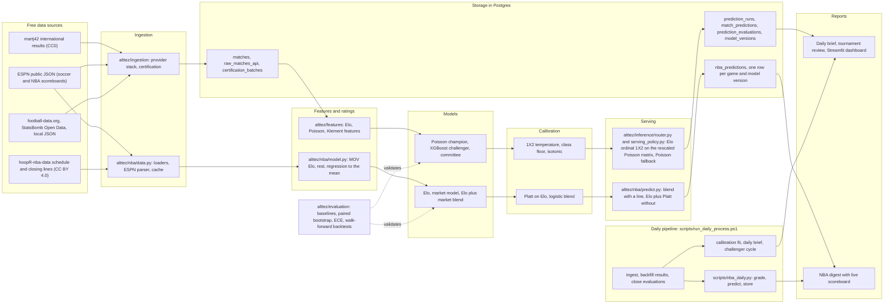

# Architecture

ALTTEZ runs two prediction pipelines on one evaluation library. The soccer pipeline predicts 1X2 outcomes and scorelines for national-team matches. The NBA pipeline predicts the home win probability of each game. Both write to Postgres (Supabase), run from one daily process, and score their models with the same paired bootstrap code in `alttez/evaluation/`.

## Data flow

## Soccer

`alttez/ingestion/provider_stack.py` builds an ordered chain of providers, each behind the `MatchProvider` contract in `providers/base.py`. Raw rows land in `raw_matches_api`, are certified in batches, and become canonical matches. `alttez/features/klement.py` holds the only feature schema (`MODEL_FEATURE_COLUMNS`) that training and inference share.

`alttez/inference/router.py` resolves the active model from `public.model_versions`. If the registry or the artifact is unavailable, it serves the Poisson champion and records `used_fallback` and `fallback_reason`. By default the single predictor then applies `alttez/inference/serving_policy.py`. It rates every stored match before the target date, fits an ordinal draw model on the trailing four years, and rescales the Poisson score matrix by class ratios to the resulting Elo 1X2, so the 1X2 and the scoreline agree. The payload carries `serving_policy` and the raw Poisson 1X2, which the calibration fit still reads. A team without an Elo rating serves Poisson for that match and is flagged as a fallback. `ALTTEZ_SERVING_POLICY=off` restores plain Poisson. `prediction_committee.py` blends the member score matrices, then applies the champion's serving policy to the blend, so the committee serves the same Elo 1X2 as the single predictor and its payload names the policy. The members stay raw and are kept as diagnostics. The committee payload reports `used_fallback` and `fallback_reason` for the match being predicted, including a member that lost its Elo rating for one team. `alttez/training/challenger_cycle.py` marks a challenger eligible only when the paired Brier difference has a 95% interval below 0 on at least 200 identical matches against both the production Poisson champion and the Elo-only baseline, with no material log-loss deterioration against either. Automatic promotion stays off unless `ALTTEZ_AUTO_PROMOTE_MODELS` is true.

An active model that is not Poisson, such as XGBoost, replaces the Elo policy instead of inheriting it. Promoted through `challenger_cycle`, it has beaten the Elo-only baseline under the same rule, so the Elo rescale is not forced onto it and its payload reports `serving_policy` as `none`.

Validation evidence is in [validation_soccer.md](validation_soccer.md). The history of the defects it exposed is in [model-history.md](model-history.md).

## NBA

`alttez/nba/data.py` downloads the hoopR schedule and closing lines, caches them under `artifacts/nba/`, and parses the ESPN scoreboard. Tests never use the network. `model.py` fits the MOV Elo, the market model and the blend. `evaluate.py` runs the walk-forward validation. `predict.py` serves a prediction per upcoming game, and `store.py` writes each row once to `public.nba_predictions` (an Elo row, plus a blend row if a line appears later) and grades both after the game.

The freshness gate, the served-model policy and the exit codes are in [nba.md](nba.md).

## Shared evaluation

`alttez/evaluation/paired.py` provides `paired_bootstrap_diff` (resampling rows or blocks such as game dates), per-game Brier and log loss, and `expected_calibration_error`. `baselines.py` provides the uniform, base-rate and Elo-only 1X2 baselines. `soccer_backtest.py` runs the soccer walk-forward backtest.
