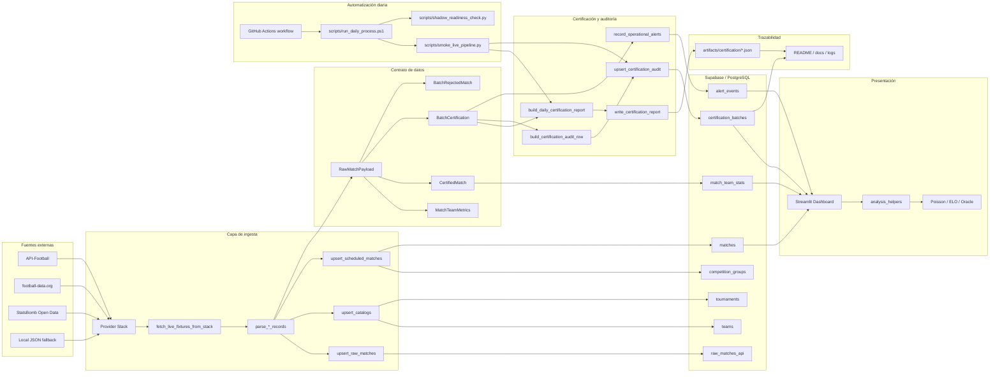
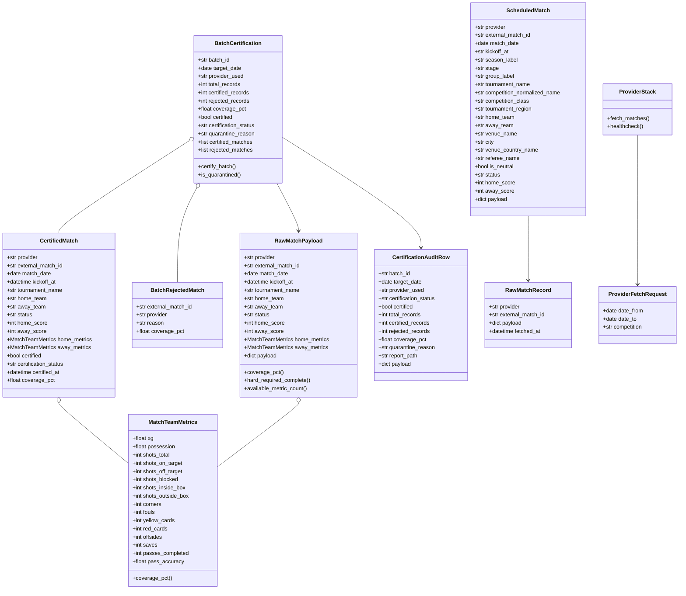
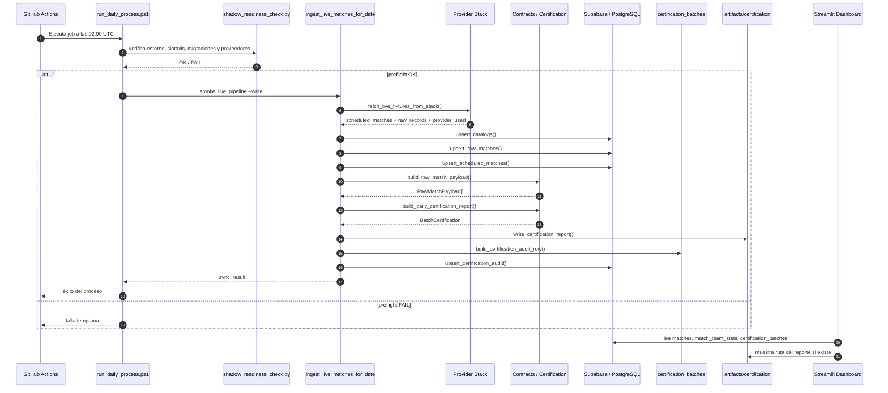
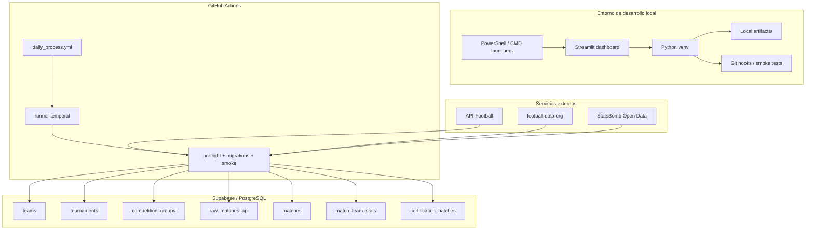

# ALTTEZ Fase 2 — UML de arquitectura y flujo operativo

Este documento resume el estado actual del trabajo en ALTTEZ Fase 2:

- la rama activa es `desarrollo`
- la ingesta diaria ya corre con orquestación ligera en GitHub Actions
- la certificación de lotes escribe reporte local y ahora también persiste auditoría histórica en Supabase
- el dashboard muestra el estado de sincronización, cobertura y certificación
- la carpeta `screenshots/` quedó fuera del índice del repositorio y ya no forma parte del flujo del proyecto

La arquitectura se divide en cuatro capas principales:

1. **Extracción e ingesta**
2. **Validación, certificación y auditoría**
3. **Persistencia y consulta**
4. **Presentación y operación**

---

## 1) Diagrama de componentes

---

## 2) Diagrama de clases

---

## 3) Diagrama de secuencia — proceso diario

---

## 4) Diagrama de despliegue

---

## 5) Lectura rápida del estado actual

### Ya está operativo

- ingesta multi-provider con fallback
- normalización de equipos, torneos y grupos
- contrato de datos con `RawMatchPayload` y `CertifiedMatch`
- certificación de lotes diarios
- reporte JSON de certificación en `artifacts/certification/`
- auditoría persistida en `certification_batches`
- alertas operativas persistidas en `alert_events`
- dashboard con estado de sincronización y certificación
- workflow diario en GitHub Actions
- smoke test y readiness check

### Todavía puede crecer

- alertas automáticas para lotes cuarentenados
- notificación opcional por webhook para alertas críticas
- vista materializada de lotes certificados para consumo analítico
- dbt tests para validación de cobertura y rangos
- panel histórico de auditoría en el dashboard
- mejor observabilidad de proveedores y errores

---

## 6) Archivo relacionado

- [README.md](../../README.md)
- [docs/provider-stack.md](../provider-stack.md)
- [sql/supabase/migrations/006_certification_batches.sql](../../sql/supabase/migrations/006_certification_batches.sql)
